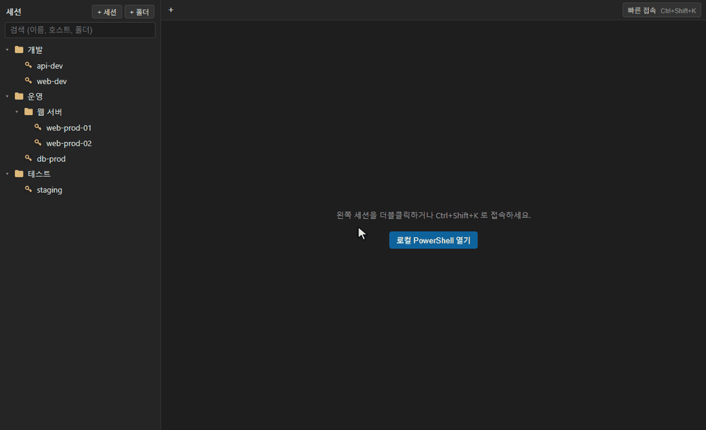

# terminal-manager

[한국어](README.md) | **English**

The more servers you manage, the more tedious SSH logins and file transfers become.
terminal-manager is a Windows / macOS desktop app focused on two things: **organizing SSH sessions into folders**, and **transferring files over SFTP** right from the tab you're connected in.



The app switches between Korean and English automatically based on your OS language. You can also switch with the `English / 한국어` button at the top right.

## Key features

### 1. Organize sessions into folders

- Create **folders and subfolders** in the sidebar to group servers, e.g. `dev / prod / test`.
- **Drag** sessions and folders into other folders; drop on empty space to move them to the top level.
- Each session stores a name, host (IP or domain), port, username, and auth method (PEM key / password). Sessions can be duplicated.
- **Double-click** a session to connect in a new tab.
- **Quick Connect**: press `Ctrl+Shift+K` (macOS `Cmd+Shift+K`), type part of a name, host, or folder, then press Enter.
  You can also press Enter in the sidebar search box to connect.
- Deleting a folder moves its sessions up to the parent folder, so sessions are never lost along with it.

### 2. Easy SFTP

- **Drag-and-drop upload**: drop files or folders onto an SSH tab to upload them. Folders upload with all their contents, with a progress bar.
  If a file with the same name exists, you're asked before it's overwritten.
- **Remote file panel**: open it with the `📁 Files` button on the right of an SSH tab.
  - Browse folders (double-click · ⬆ · ⌂ · type a path), see size / date / permissions, show hidden files
  - Drop onto the panel to upload into **the folder you're viewing**, or onto a folder row to upload into **that folder**.
  - Download, new folder, rename, delete (buttons · right-click menu · `F2` / `Delete` / `Ctrl+A` / arrow keys)
  - Multi-select: click, `Ctrl+click`, `Shift+click`
  - The `cd here` button moves the terminal to the panel's folder.
- Folders you can't access show `Permission denied: <path>`; the app follows the permissions of the account you logged in with.
- Deleting asks for confirmation. Your home folder and `/` can't be deleted.

### Other features

- Tabbed terminals: SSH tabs and local terminal tabs (Windows: PowerShell, macOS: your default login shell)
- Proper UTF-8 display, automatic resizing, keepalive
- A disconnected tab can reconnect with the `Reconnect` button. Connection errors explain the cause and how to fix it.
- Selecting text copies it automatically; right-click in the terminal to paste

## Installation

Download the file for your OS from [Releases](../../releases).

### Windows

1. Run `terminal-manager-<version>-setup.exe`.
2. If "Windows protected your PC" appears, click **More info → Run anyway**. (The app isn't code-signed, so this appears the first time.)
3. After installing, launch `terminal-manager` from the desktop or Start menu.

### macOS

1. Download the dmg that matches your Mac.
   - Apple Silicon (M1 or later): `terminal-manager-<version>-arm64.dmg`
   - Intel Mac: `terminal-manager-<version>-x64.dmg`
   - Not sure? Apple menu → About This Mac → if "Chip" starts with Apple M, it's arm64.
2. Open the dmg and drag `terminal-manager` into the **Applications** folder.
3. The first launch is blocked with an "unidentified developer" warning (the app isn't notarized by Apple).
   Click **Open Anyway** in **System Settings → Privacy & Security**, or run this once in Terminal:

   ```bash
   xattr -cr /Applications/terminal-manager.app
   ```

4. When saving a password, if a Keychain access prompt appears, click **Always Allow**.

## Keyboard shortcuts

| Action | Windows | macOS |
|---|---|---|
| Quick Connect | `Ctrl+Shift+K` | `Cmd+Shift+K` |
| New local terminal tab | `Ctrl+Shift+T` | `Cmd+Shift+T` |
| Next / previous tab | `Ctrl+Tab` / `Ctrl+Shift+Tab` | `Ctrl+Tab` / `Ctrl+Shift+Tab` |
| Close tab | Middle-click the tab or `×` | Middle-click the tab or `×` |

Why `Ctrl+Shift+K` instead of `Ctrl+K`: in a shell, `Ctrl+K` means "delete to end of line".

## No personal data is collected

terminal-manager is a program each person installs and runs on their own computer. The author receives no information about you.

- There is no sign-up, login, or account.
- There are no usage statistics, crash reports, ads, or tracking code.
- The app does not check for updates on its own. Download new versions from [Releases](../../releases).
- The only places the app connects to over the network are **the SSH servers you register and connect to yourself**.
- Session details, passwords, and transferred files travel only between your computer and the server you connect to. Nothing is sent to the author or anywhere else.
- Uninstalling the app and deleting the storage folder below removes everything the app saved.
  On macOS, also delete the `terminal-manager Safe Storage` item in Keychain Access.

In short, **if your computer is safe, your connection details are safe.**
Because nothing leaves your computer, the most important thing is to protect your OS account password and lock your screen.

The source code is fully public, so you can verify all of the above yourself.

## Storage and security

- Sessions and folders are saved in `sessions.json`, host keys in `known_hosts.json`.
  - Windows: `%APPDATA%\terminal-manager\`
  - macOS: `~/Library/Application Support/terminal-manager/`
- **Passwords and passphrases are never stored in plain text.** Only values encrypted by the OS (Windows DPAPI / macOS Keychain) are stored,
  and they can only be decrypted by your current OS account. Leave the password empty to be asked every time you connect.
- **For PEM keys, only the path** is stored, never the key contents.
- The first time you connect to a server, its host key fingerprint (SHA256) is shown and you're asked whether to trust it. If the key changes later, a warning appears and "Cancel" is the default.
- Secrets are never sent to the UI (renderer); decryption happens in the main process right before connecting.

## Running from source (for development)

Requires Node.js 22 or later. `node-pty` (used for local terminals) ships prebuilt binaries for Windows / macOS (x64 · arm64),
so it installs without Visual Studio Build Tools or Xcode.

### Windows (PowerShell)

```powershell
git clone https://github.com/sys970717/terminal-manager.git
cd terminal-manager
npm install
npm run dev
```

Build an installer: `npm run build:win` → `dist\terminal-manager-<version>-setup.exe`

### macOS (Terminal)

```bash
git clone https://github.com/sys970717/terminal-manager.git
cd terminal-manager
npm install
npm run dev
```

Build a dmg: `npm run build:mac` → `dist/terminal-manager-<version>-<arm64|x64>.dmg` (macOS only)

### Common

- In development mode, press `F12` to open DevTools.
- UI changes apply immediately; after changing code in `src/main`, restart the app.
- To test without touching your real sessions, change the storage folder with `TM_USER_DATA`.
  - Windows: `$env:TM_USER_DATA="$env:TEMP\tm-test"; npm run dev`
  - macOS: `TM_USER_DATA=/tmp/tm-test npm run dev`
- Checks: `npm test`, `npm run typecheck`, `npm run lint`
- Pushing a tag such as `v1.0.0` makes GitHub Actions build the Windows exe and macOS dmg and publish them to Releases.
- UI text lives in `src/renderer/src/locales/` and main-process messages in `src/main/locales/` (`ko.ts` / `en.ts`).

## Tech stack

| Area | Technology |
|---|---|
| App | Electron + electron-vite, React + TypeScript |
| Terminal | `@xterm/xterm`, `node-pty` |
| SSH / SFTP | `ssh2` |
| Secret storage | Electron `safeStorage` |

SSH, SFTP, and local shells all run in the main process; the UI (React) talks to it only through the preload API.

## Known limitations

- `.ppk` keys are only partially supported. If one doesn't work, convert it to OpenSSH format (.pem).
- Connecting through a jump host (bastion) isn't supported yet.

## License

Licensed under the [PolyForm Perimeter License 1.0.0](LICENSE.md). In short (the full text in [LICENSE.md](LICENSE.md) is what applies):

- Individuals and companies may **install and use it for free**, including for work.
- You may modify the source for your own use.
- You may **not provide it to others as a competing product**, which includes selling or distributing this app, modified or not, as a substitute for it, even free of charge.
- It comes as is, without warranty; the author is not liable for any damage from its use.

## Bug reports / suggestions

Please report bugs or request features in [Issues](../../issues). This repository does not accept pull requests.
