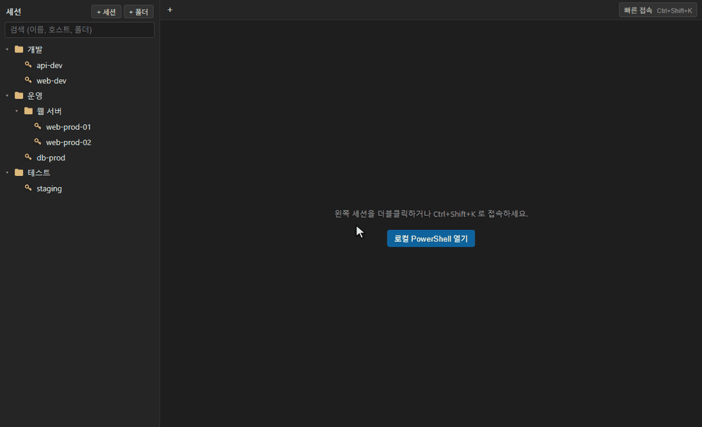

# terminal-manager

**한국어** | [English](README.en.md)

서버가 많아질수록 SSH 접속 정보와 파일 전송이 번거로워집니다.
terminal-manager는 **SSH 세션을 폴더로 정리**하고, 접속한 탭에서 바로 **SFTP로 파일을 주고받는** 데 집중한 Windows / macOS 데스크톱 앱입니다.



OS 언어에 따라 한국어 / 영어로 자동으로 나오며, 오른쪽 위 `English / 한국어` 버튼으로 바꿀 수 있습니다.

## 핵심 기능

### 1. 세션을 폴더로 관리

- 사이드바에서 **폴더 / 하위 폴더**를 만들어 `개발 / 운영 / 테스트`처럼 서버를 묶습니다.
- 세션과 폴더를 **드래그**로 다른 폴더에 옮기고, 빈 곳에 놓으면 최상위로 나옵니다.
- 세션 하나에 이름, 호스트(IP 또는 도메인), 포트, 계정, 인증 방식(PEM 키 / 비밀번호)을 저장합니다. 복제도 됩니다.
- 세션을 **더블클릭**하면 새 탭에서 바로 접속합니다.
- **빠른 접속**: `Ctrl+Shift+K` (macOS `Cmd+Shift+K`)를 누르고 이름·호스트·폴더 일부를 입력한 뒤 Enter.
  사이드바 검색창에서도 Enter로 접속합니다.
- 폴더를 지우면 안에 있던 세션은 상위 폴더로 옮겨지므로 세션이 같이 사라지지 않습니다.

### 2. 간편한 SFTP

- **끌어다 놓기 업로드**: SSH 탭에 파일·폴더를 끌어다 놓으면 업로드됩니다. 폴더는 하위 내용까지 올라가고, 진행률이 보입니다.
  같은 이름이 있으면 덮어쓸지 먼저 묻습니다.
- **원격 파일 패널**: SSH 탭 오른쪽 `📁 파일` 버튼으로 엽니다.
  - 폴더 탐색(더블클릭 · ⬆ · ⌂ · 주소 직접 입력), 크기 / 날짜 / 권한 표시, 숨김 파일 보기
  - 패널에 끌어다 놓으면 **보고 있는 폴더**로, 폴더 줄 위에 놓으면 **그 폴더**로 업로드합니다.
  - 다운로드, 새 폴더, 이름 변경, 삭제 (버튼 · 우클릭 메뉴 · `F2` / `Delete` / `Ctrl+A` / 화살표 키)
  - 여러 개 선택: 클릭, `Ctrl+클릭`, `Shift+클릭`
  - `터미널을 여기로 cd` 버튼으로 터미널 위치를 패널 폴더로 맞춥니다.
- 권한 없는 폴더는 `권한 없음: <경로>`로 알려주고, 접속한 계정의 권한을 그대로 따릅니다.
- 삭제는 확인 창을 거칩니다. home과 `/`는 지울 수 없습니다.

### 그 밖의 기능

- 탭형 터미널: SSH 탭과 로컬 터미널 탭(Windows: PowerShell, macOS: 기본 로그인 셸)
- 한글(UTF-8) 정상 표시, 창 크기 자동 맞춤, 연결 유지(keepalive)
- 연결이 끊긴 탭은 `다시 연결` 버튼으로 다시 붙습니다. 연결 오류는 원인과 해결 방법을 한국어로 보여줍니다.
- 드래그로 선택하면 자동 복사, 터미널 우클릭으로 붙여넣기

## 설치 (사용자용)

[Releases](../../releases)에서 운영체제에 맞는 파일을 받습니다.

### Windows

1. `terminal-manager-<버전>-setup.exe`를 실행합니다.
2. "Windows의 PC 보호" 창이 뜨면 **추가 정보 → 실행**을 누릅니다. (코드 서명이 없는 앱이라 처음 한 번 뜹니다)
3. 설치가 끝나면 바탕화면과 시작 메뉴의 `terminal-manager`로 실행합니다.

### macOS

1. Mac 종류에 맞는 dmg를 받습니다.
   - Apple Silicon(M1 이후): `terminal-manager-<버전>-arm64.dmg`
   - Intel Mac: `terminal-manager-<버전>-x64.dmg`
   - 모르겠으면  메뉴 → 이 Mac에 관하여 → "칩"이 Apple M으로 시작하면 arm64입니다.
2. dmg를 열고 `terminal-manager`를 **Applications** 폴더로 끌어다 놓습니다.
3. 처음 실행하면 "확인되지 않은 개발자" 경고로 막힙니다(Apple 공증을 받지 않은 앱).
   **시스템 설정 → 개인정보 보호 및 보안**에서 **그래도 열기**를 누르거나, 터미널에서 아래를 한 번 실행하세요.

   ```bash
   xattr -cr /Applications/terminal-manager.app
   ```

4. 비밀번호를 저장할 때 키체인 접근 허용 창이 뜨면 **항상 허용**을 누릅니다.

## 단축키

| 동작 | Windows | macOS |
|---|---|---|
| 빠른 접속 | `Ctrl+Shift+K` | `Cmd+Shift+K` |
| 새 로컬 터미널 탭 | `Ctrl+Shift+T` | `Cmd+Shift+T` |
| 다음 / 이전 탭 | `Ctrl+Tab` / `Ctrl+Shift+Tab` | `Ctrl+Tab` / `Ctrl+Shift+Tab` |
| 탭 닫기 | 탭 가운데 클릭 또는 `×` | 탭 가운데 클릭 또는 `×` |

`Ctrl+K` 대신 `Ctrl+Shift+K`를 쓰는 이유: 셸에서 `Ctrl+K`는 "커서 뒤 지우기"라서 겹칩니다.

## 개인정보를 수집하지 않습니다

terminal-manager는 각자 자기 PC에 설치해서 쓰는 프로그램입니다. 제작자는 사용자에 대한 어떤 정보도 받지 않습니다.

- 회원가입, 로그인, 계정이 없습니다.
- 사용 통계, 오류 보고, 광고, 추적 코드가 들어 있지 않습니다.
- 업데이트를 자동으로 확인하지 않습니다. 새 버전은 [Releases](../../releases)에서 직접 받습니다.
- 앱이 네트워크로 연결하는 곳은 **사용자가 직접 등록하고 접속한 SSH 서버뿐**입니다.
- 세션 정보, 비밀번호, 주고받는 파일은 내 PC와 내가 접속한 서버 사이에서만 오갑니다. 제작자나 다른 곳으로 전송되지 않습니다.
- 앱을 삭제하고 아래 저장 폴더까지 지우면 앱이 남긴 데이터는 모두 사라집니다.
  macOS는 키체인 접근에서 `terminal-manager Safe Storage` 항목도 함께 지우세요.

한마디로, **내 PC가 안전하면 내 접속 정보도 안전합니다.**
정보가 내 PC 밖으로 나가지 않으므로, 대신 PC 계정 비밀번호와 화면 잠금을 잘 관리하는 것이 가장 중요합니다.

소스 코드가 모두 공개돼 있으니 위 내용을 직접 확인할 수 있습니다.

## 저장 위치와 보안

- 세션·폴더는 `sessions.json`, 호스트 키는 `known_hosts.json`에 저장합니다.
  - Windows: `%APPDATA%\terminal-manager\`
  - macOS: `~/Library/Application Support/terminal-manager/`
- **비밀번호 / 키 암호는 평문으로 저장하지 않습니다.** OS 암호화(Windows DPAPI / macOS 키체인)로 암호화한 값만 저장하며,
  현재 OS 계정에서만 풀 수 있습니다. 비밀번호를 비워두면 접속할 때마다 입력받습니다.
- **PEM 키는 경로만** 저장하고 키 내용은 저장하지 않습니다.
- 처음 접속하는 서버는 호스트 키 지문(SHA256)을 보여주고 저장할지 묻습니다. 이후 키가 바뀌면 경고 창을 띄우고 기본값은 "취소"입니다.
- 화면(렌더러)에는 비밀값을 보내지 않고, 복호화는 접속 직전에 메인 프로세스에서만 합니다.

## 소스에서 실행 (개발용)

Node.js 22 이상이 필요합니다. 로컬 터미널용 `node-pty`가 Windows / macOS(x64·arm64)용 빌드를 포함하므로
Visual Studio Build Tools나 Xcode 없이 설치됩니다.

### Windows (PowerShell)

```powershell
git clone https://github.com/sys970717/terminal-manager.git
cd terminal-manager
npm install
npm run dev
```

설치 파일 만들기: `npm run build:win` → `dist\terminal-manager-<버전>-setup.exe`

### macOS (터미널)

```bash
git clone https://github.com/sys970717/terminal-manager.git
cd terminal-manager
npm install
npm run dev
```

dmg 만들기: `npm run build:mac` → `dist/terminal-manager-<버전>-<arm64|x64>.dmg` (Mac에서만 가능)

### 공통

- 개발 모드에서 `F12`로 개발자 도구를 엽니다.
- 화면 코드는 바로 반영되고, `src/main` 코드를 고치면 앱을 다시 켜야 합니다.
- 실제 세션과 분리해서 시험하려면 `TM_USER_DATA`로 저장 폴더를 바꿉니다.
  - Windows: `$env:TM_USER_DATA="$env:TEMP\tm-test"; npm run dev`
  - macOS: `TM_USER_DATA=/tmp/tm-test npm run dev`
- 검사: `npm test`, `npm run typecheck`, `npm run lint`
- `v1.0.0` 같은 태그를 push하면 GitHub Actions가 Windows exe와 macOS dmg를 빌드해 Releases에 올립니다.
- 화면 문구는 `src/renderer/src/locales/`, main 프로세스 메시지는 `src/main/locales/`(`ko.ts` / `en.ts`)에 있습니다.

## 기술 스택

| 영역 | 사용 기술 |
|---|---|
| 앱 | Electron + electron-vite, React + TypeScript |
| 터미널 | `@xterm/xterm`, `node-pty` |
| SSH / SFTP | `ssh2` |
| 비밀 저장 | Electron `safeStorage` |

SSH / SFTP / 로컬 셸은 모두 메인 프로세스에서 처리하고, 화면(React)은 preload API를 통해서만 통신합니다.

## 알려진 사항

- `.ppk` 형식 키는 일부만 지원합니다. 안 되면 OpenSSH 형식(.pem)으로 변환해서 지정하세요.
- 점프 호스트(bastion) 경유 접속은 아직 지원하지 않습니다.

## 라이선스

[PolyForm Perimeter License 1.0.0](LICENSE.md)을 따릅니다. 요약하면 다음과 같습니다. 정확한 조건은 [LICENSE.md](LICENSE.md) 원문이 기준입니다.

- 개인과 회사 모두 **무료로 설치해서 쓸 수 있습니다.** 업무용으로 써도 됩니다.
- 소스를 고쳐서 쓰는 것도 됩니다.
- 이 앱을 대신하는 **경쟁 제품으로 제공하는 것은 안 됩니다.** 이 앱을 그대로 또는 고쳐서 팔거나 배포하는 경우가 여기에 들어가며, 무료로 나눠 주는 것도 포함됩니다.
- 보증 없이 "있는 그대로" 제공되며, 사용으로 생긴 문제에 제작자는 책임지지 않습니다.

## 버그 제보 / 제안

버그나 필요한 기능은 [Issues](../../issues)에 남겨 주세요. 이 저장소는 Pull Request를 받지 않습니다.
